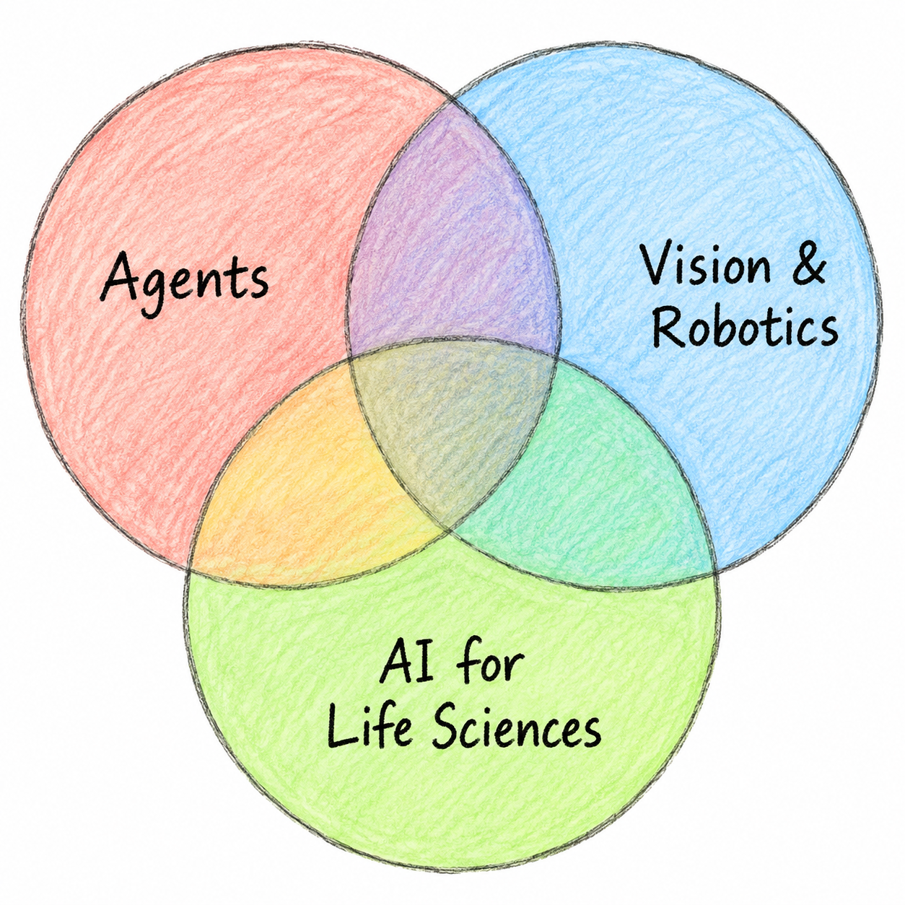

# Hi, I'm [Jusheng Zhang](https://jushengzhang.github.io/)

[Homepage](https://jushengzhang.github.io/) · [Google Scholar](https://scholar.google.com/citations?user=-EvMmxoAAAAJ) · [Email](mailto:jusheng@stanford.edu)

My research connects reliable agents, efficient visual intelligence, and embodied decision-making. My goal is to help build the next generation of **AI agents for scientific discovery**.

## About Me

- **Stanford University** — Visiting Researcher, working on agentic AI for life sciences.
- **Google DeepMind** — Student Researcher, working on efficient video and vision-language models.
- **Education** — B.S. in Computer Science and Technology, University of Electronic Science and Technology of China.

## Research Interests

- **Agents** — collaboration, uncertainty-aware reasoning, and learning from failures.
- **Vision-language models** — token compression, visual reasoning, and video representations.
- **Robotics** — cooperative planning and world-action modeling.
- **AI for science** — agents that support scientific research and discovery.

  

## Selected Research & Code

- **[Self-Rewarded Multimodal Coherent Reasoning Across Diverse Visual Domains](https://neurips.cc/virtual/2026/poster/149029)**  
  NeurIPS 2026 · **Spotlight**
- **[Failure-Driven Workflow Refinement](https://openreview.net/forum?id=GbYHY1RVUa)**  
  ICML 2026 · **Spotlight**
- **[Hybrid Token Compression for Vision-Language Models](https://openaccess.thecvf.com/content/CVPR2026/papers/Zhang_Hybrid_Token_Compression_for_Vision-Language_Models_CVPR_2026_paper.pdf)**  
  CVPR 2026 · **Highlight** · [Code](https://github.com/jushengzhang/HybridToken-VLM)

**More code:** [GAM-Agent](https://github.com/jushengzhang/Gam-Agent) · [CF-VLM](https://github.com/HCP-AI-Research-Lab/CF-VLM) · [3D-Agent](https://github.com/jushengzhang/3D-Agent)

[All publications](https://jushengzhang.github.io/#publications) · [Google Scholar](https://scholar.google.com/citations?user=-EvMmxoAAAAJ)

## Experience Highlights

- **Nanyang Technological University** — Research Intern.
- **Meta AI** — Research Intern, Llama 4 team.
- **Snap Research** — Research Collaborator.
- **HCP Lab, Sun Yat-sen University** — Lab Researcher.
- **Ant Group** — Risk Control Algorithm Expert, 2018–2023.

I am grateful to Prof. Keze Wang for giving me the opportunity to begin my research journey.

## Professional Service

- **Lead Organizer**, [LoViF Challenge on Efficient VLMs](https://lovif-cvpr2026-workshop.github.io/), CVPR 2026.
- **Organizer**, [LoViF ActPhysCause Challenge](https://actphyscause-challenge.x-era.com/), ECCV 2026.
- **Reviewer** for NeurIPS, ICML, ICLR, CVPR, ICCV, and ECCV, among others.

## Let's Connect

[Email](mailto:jusheng@stanford.edu) · [Homepage](https://jushengzhang.github.io/) · [Google Scholar](https://scholar.google.com/citations?user=-EvMmxoAAAAJ) · [LinkedIn](https://www.linkedin.com/in/%E5%B7%A8%E5%A3%B0-%E5%BC%A0-50510b1b8/)

---

My earlier GitHub accounts are no longer accessible. I’m gradually migrating and reorganizing my projects under this account.
